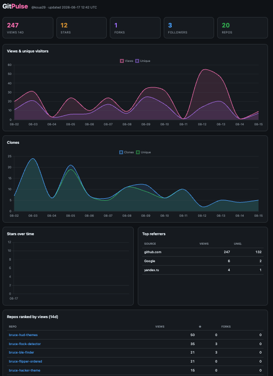
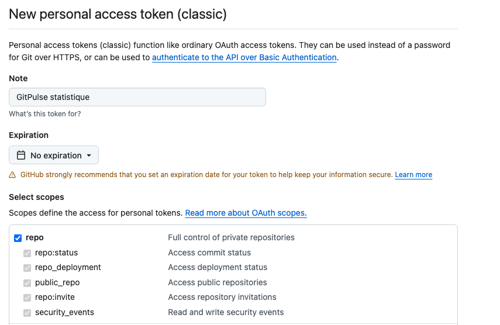

# 📊 GitPulse

<p align="center">🇺🇸 <a href="README.md">English</a> · 🇫🇷 <b>Français</b></p>

**Des statistiques GitHub auto-hébergées — parce que GitHub ne garde le trafic que 14 jours et n'a pas de tableau de bord pour tout le compte.**

Une GitHub Action tourne une fois par jour, récupère les vues / visiteurs uniques / clones / sites référents / étoiles / forks / abonnés de **chaque dépôt public que tu possèdes**, et **les fusionne dans des fichiers d'historique commités dans le dépôt** — tes données survivent donc à la fenêtre de 14 jours. Un tableau de bord statique sur **GitHub Pages** met le tout en graphiques.

> ⚡ **Zéro serveur, zéro coût, fonctionne même ordinateur éteint.** Tout vit sur GitHub : la planification (Actions), le stockage (git) et le tableau de bord (Pages).



🔗 **Démo en ligne :** [koua29.github.io/gitpulse](https://koua29.github.io/gitpulse/)

---

## ✨ Ce que tu obtiens

- 📈 Un **historique illimité** des vues / visiteurs uniques / clones — par dépôt *et* cumulé sur tout le compte
- ⭐ L'évolution des **étoiles, forks et abonnés**
- 🌍 Les **principaux sites référents** et les contenus populaires
- 🏆 Un **classement des dépôts** par trafic
- 🖥️ Un **tableau de bord graphique sur GitHub Pages** (Chart.js, thème sombre, adapté au mobile)
- 🔖 Un **badge mis à jour automatiquement**, en option, pour le README de ton profil

## ⚙️ Comment ça marche

```
cron 06:17 UTC ─▶ GitHub Action ─▶ collect.py ─▶ fusion dans data/ ─▶ git commit ─▶ Pages se met à jour
                                        └▶ update_profile.py ─▶ badge dans le README <toi>/<toi>
```

| Fichier | Rôle |
|---|---|
| `collect.py` | Le collecteur — Python **bibliothèque standard uniquement, aucune dépendance** |
| `update_profile.py` | Insère le badge de statistiques dans le README de ton profil (optionnel) |
| `.github/workflows/collect.yml` | La planification quotidienne + le commit automatique |
| `data/` | L'historique accumulé (JSON, versionné par git) |
| `docs/` | Le tableau de bord GitHub Pages (HTML statique + Chart.js) |

---

## 🚀 Le déployer sur ton propre compte GitHub

Rien à installer en local. Tout se fait sur github.com et prend ~5 minutes.

### 1. Récupérer le code sur ton compte

Clique sur **[Use this template ▸ Create a new repository](https://github.com/koua29/gitpulse/generate)** (ou **Fork**), et nomme-le par exemple `gitpulse`.

> Le workflow lit le propriétaire depuis `github.repository_owner` : **tu n'as pas une seule ligne à modifier** — il cible automatiquement le propriétaire du dépôt.

### 2. Créer un jeton d'accès personnel (PAT)

L'API de trafic de GitHub exige un **accès en écriture** : il te faut donc un jeton avec la portée `repo`.

Va dans **[Settings ▸ Developer settings ▸ Personal access tokens ▸ Tokens (classic)](https://github.com/settings/tokens)** → **Generate new token (classic)** :

- **Note :** ce que tu veux, par ex. `GitPulse`
- **Expiration :** à toi de voir (si tu en mets une, pense à le renouveler, sinon la tâche quotidienne s'arrêtera sans prévenir)
- **Scopes :** coche **`repo`** — cette seule case de premier niveau suffit



Clique sur **Generate token** et **copie-le** (il n'est affiché qu'une fois).

### 3. Ajouter le jeton comme secret du dépôt

Dans **ton** dépôt GitPulse → **Settings ▸ Secrets and variables ▸ Actions ▸ New repository secret** :

- **Name :** `GITPULSE_TOKEN`
- **Secret :** colle le jeton

Ou avec la [CLI GitHub](https://cli.github.com/) :

```bash
gh secret set GITPULSE_TOKEN --repo TON-PSEUDO/gitpulse
```

### 4. Activer GitHub Pages

Dépôt → **Settings ▸ Pages** → **Source : Deploy from a branch**, branche **`main`**, dossier **`/docs`** → **Save**.

Ton tableau de bord sera à l'adresse `https://TON-PSEUDO.github.io/gitpulse/`.

### 5. Le lancer une première fois

Dépôt → **Actions ▸ GitPulse collect ▸ Run workflow**. Cela crée le premier relevé ; ensuite il tourne automatiquement chaque jour.

### 6. (Optionnel) Badge dans le README du profil

Si tu as un [README de profil](https://docs.github.com/en/account-and-profile/setting-up-and-managing-your-github-profile/customizing-your-profile/managing-your-profile-readme) (un dépôt qui porte exactement ton nom d'utilisateur), colle ces deux marqueurs à l'endroit où tu veux le badge :

```markdown
<!--GITPULSE:START-->
<!--GITPULSE:END-->
```

Chaque exécution quotidienne réécrit le bloc entre les deux, par exemple :

> 📊 **247** views (14d) · ⭐ **12** stars · 🍴 **1** forks · 👥 **3** followers · across **20** repos

Si tu n'as pas de README de profil, cette étape est ignorée automatiquement — rien à faire.

---

## 🔒 Confidentialité

GitPulse ne collecte que les **dépôts publics** (`visibility=public`, plus un filtre de sécurité). Les noms et le trafic des dépôts privés ne sont **jamais** écrits sur disque ni dans le tableau de bord — tu peux publier le tableau de bord sans risque.

## 🛠️ Personnaliser

- **Planification :** modifie la ligne `cron:` dans `.github/workflows/collect.yml` ([syntaxe crontab](https://crontab.guru/), en UTC).
- **Apparence du tableau de bord :** c'est du HTML/CSS simple dans `docs/index.html` — ajuste les couleurs dans le bloc `:root`.
- **Lancer en local :**
  ```bash
  export GITHUB_TOKEN=ghp_xxx
  export GH_USER=TON-PSEUDO
  python collect.py
  ```

## 📚 À lire

*Liens partenaires Amazon : si vous achetez via ces liens, le projet touche une petite commission, sans surcoût pour vous.*

<table>
<tr>
<td align="center" width="33%">
  <a href="https://www.amazon.fr/dp/1394159161?linkCode=ll2&amp;tag=koua29gitpulse-21&amp;ref_=as_li_ss_tl"></a><br>
  <b><a href="https://www.amazon.fr/dp/1394159161?linkCode=ll2&amp;tag=koua29gitpulse-21&amp;ref_=as_li_ss_tl">GitHub For Dummies (en anglais)</a></b><br><sub>Le contrôle de version et les pull requests, pas à pas</sub>
</td>
<td align="center" width="33%">
  <a href="https://www.amazon.fr/dp/0135957052?linkCode=ll2&amp;tag=koua29gitpulse-21&amp;ref_=as_li_ss_tl"></a><br>
  <b><a href="https://www.amazon.fr/dp/0135957052?linkCode=ll2&amp;tag=koua29gitpulse-21&amp;ref_=as_li_ss_tl">The Pragmatic Programmer (en anglais)</a></b><br><sub>Le classique du métier, 20 ans après</sub>
</td>
<td align="center" width="33%">
  <a href="https://www.amazon.fr/dp/B0F6S5425Y?linkCode=ll2&amp;tag=koua29gitpulse-21&amp;ref_=as_li_ss_tl"></a><br>
  <b><a href="https://www.amazon.fr/dp/B0F6S5425Y?linkCode=ll2&amp;tag=koua29gitpulse-21&amp;ref_=as_li_ss_tl">Beyond Vibe Coding (en anglais)</a></b><br><sub>Du codeur au développeur de l'ère IA</sub>
</td>
</tr>
</table>

<sub>En tant que Partenaire Amazon, je réalise un bénéfice sur les achats remplissant les conditions requises.</sub>

## ☕ Soutien / Offrez-moi un café

Si GitPulse t'est utile, un café fait toujours plaisir 🙏


## 📝 Licence

MIT — voir [LICENSE](LICENSE). Fait pour être forké.
